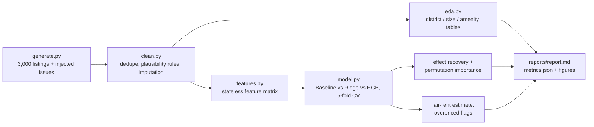
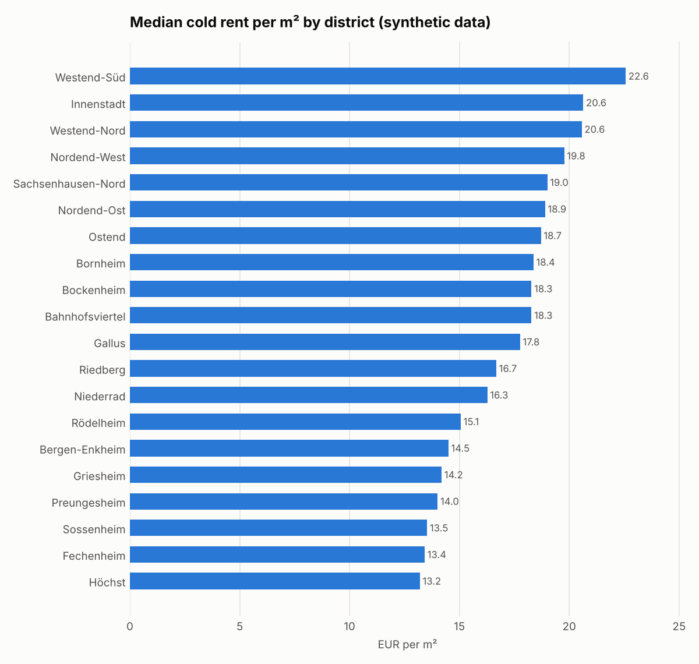
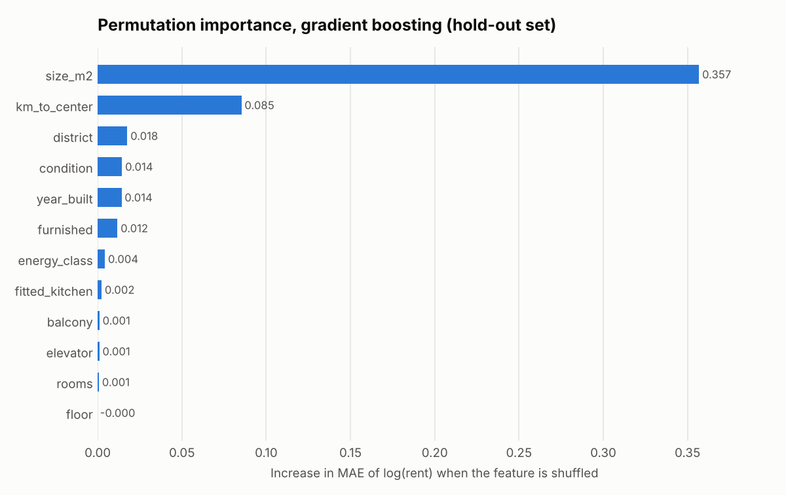

# Frankfurt Rent Price Analysis

Clean messy rental listings, explain what drives cold rent in Frankfurt-style data, and
predict a "fair rent". A tested end-to-end pipeline using pandas and scikit-learn.

[](https://github.com/SurajKumarrrrr/frankfurt-rent-price-analysis/actions/workflows/ci.yml)

> **The data is synthetic.** Listings come from a deterministic generator (`seed=42`) whose
> district price levels are rough, plausible orders of magnitude for Frankfurt am Main.
> They are **not** measured market rents. All numbers below describe the simulated data
> and the method, not the real Frankfurt housing market.

## Problem

Anyone who has looked for a flat in Frankfurt knows the questions: how much is a
district premium really worth, how much more do you pay per m² for a small flat, and is
this listing overpriced? Portal data is also messy: re-posted ads, "price on request"
placeholders, typos in the size, missing build years.

The project answers three things:
1. **Cleaning:** turn raw listings into an analysis-ready table, with an audit log.
2. **Explanation:** which features drive rent, and by how much (in % premium)?
3. **Prediction:** how accurately can rent be predicted, and which listings look overpriced?

Using synthetic data has one real advantage: the true effect of every feature is known
(`TRUE_EFFECTS` in `generate.py`), so I can **check whether the model recovers the truth**.
With real data you can't do that.

## Approach



- **Data-generating process:** log(EUR/m²) = district level + size elasticity + amenities +
  build era + condition + energy class + Gaussian noise (σ = 0.08). Cold rent = EUR/m² × size.
- **Data issues injected:** 2 % re-posted duplicates, 4 % missing `year_built`, 3 % missing
  energy class, size typos (×10), `1 €` placeholders and cents-instead-of-euros rents.
- **Cleaning:** duplicates on all attributes except `listing_id`, plausibility bounds
  (12–300 m², 5–60 EUR/m²), district-median imputation for build year, `"unknown"` energy class.
- **Models** (all predict log(rent); metrics reported on the euro scale):
  - *Baseline:* district median EUR/m² × size, which is what a human would do first.
  - *Ridge:* log-linear model with one-hot districts and explicit dummies.
  - *HistGradientBoosting:* non-linear, no feature-shape assumptions.
- Features are built inside a scikit-learn `Pipeline` by a **stateless** transformer (fixed
  category lists), so there is no leakage across CV folds.

## Results

All numbers come from `make run` (3,000 generated listings, seed 42).

**Cleaning:** 3,060 raw rows → 2,961 clean rows. Removed 60 re-posted duplicates, 15 implausible
sizes and 24 implausible prices; imputed 116 build years and 86 energy classes.

**Overview:** median cold rent €1,188 for a median 66.9 m² flat; median 17.68 EUR/m²
(P10 13.22, P90 22.55).



**Small flats cost more per m²:** <40 m²: 19.29 EUR/m², 60–80 m²: 17.84, 130+ m²: 16.05.

**Model comparison (5-fold CV, mean ± std):**

| Model | MAE (€) | MAPE | R² |
|---|---:|---:|---:|
| Baseline (district median EUR/m² × size) | 147.7 ± 7.8 | 11.07 % | 0.869 |
| **Ridge (log-linear)** | **85.0 ± 4.8** | **6.55 %** | **0.957** |
| HistGradientBoosting | 95.4 ± 3.8 | 7.28 % | 0.943 |

Ridge wins because the generator is log-linear, so the linear model is correctly specified.
Its 6.55 % MAPE is close to the noise floor (σ = 0.08 in log space ≈ 6.4 % mean absolute
error). Gradient boosting has to learn the same structure from piecewise splits. On a
20 % hold-out, HGB reaches MAE €97.4, MAPE 7.61 %, R² 0.942.

**Does the model recover the truth?** Ridge coefficients vs. the generator's true effects
(log points; exp(b) − 1 ≈ % premium):

| Effect | True | Estimated |
|---|---:|---:|
| Size elasticity of EUR/m² | −0.120 | −0.117 |
| Furnished | +0.150 | +0.144 |
| New build (2015+) | +0.100 | +0.091 |
| First occupancy | +0.080 | +0.086 |
| Needs renovation | −0.100 | −0.096 |
| Fitted kitchen | +0.040 | +0.046 |
| Balcony | +0.030 | +0.027 |
| Energy class (per step A+→H) | −0.010 | −0.012 |

Every estimate is within 0.01 of the truth. **Raw vs. adjusted:** the raw median EUR/m²
gap for furnished flats is +18.9 %, but the adjusted effect is only exp(0.144) − 1 ≈ +15.5 %.
Simple group comparisons mix in confounders such as flat size and condition.



Permutation importance (HGB, hold-out) ranks `size_m2` far ahead, then `km_to_center`. The
`district` feature gets little credit (0.018) because `km_to_center` carries almost the same
information. When features are correlated, permutation importance splits the credit between
them, so it shouldn't be read as "district doesn't matter".

**Overpriced listings:** 29 of 608 hold-out listings (4.8 %) are more than 15 % above
the model's fair-rent estimate. In this synthetic data, no listing is *actually*
overpriced. These flags are just the tail of the noise, which shows how many false alarms
such a rule raises before any real signal.

The full report is written to `reports/report.md` and `reports/metrics.json`.

## How to run

```bash
make install   # pip install -r requirements.txt + editable install
make test      # 19 pytest tests
make run       # generate -> clean -> analyse -> model -> reports/ + docs/figures/
```

Requires Python 3.11+. Runs offline in about 10 seconds. Change the sample size with
`PYTHONPATH=src python -m frankfurt_rent.pipeline --n 10000`.

## Project structure

```
src/frankfurt_rent/
  generate.py   # synthetic listings, true effects, injected data-quality issues
  clean.py      # dedupe, plausibility rules, imputation, CleaningReport audit log
  eda.py        # district, size-bucket and amenity tables
  features.py   # stateless feature engineering (safe inside a Pipeline)
  model.py      # baseline, Ridge, HGB, CV, effect recovery, permutation importance
  plots.py      # README figures (matplotlib)
  pipeline.py   # end-to-end CLI
tests/          # generator, cleaning, features/EDA, models, end-to-end
docs/figures/   # figures produced by `make run`
```

## What I'd do next

- Swap in a real dataset (e.g. an open listing dump or the Frankfurt Mietspiegel tables)
  through the same `clean → features → model` interface, and check the effects against the Mietspiegel.
- Add spatial features (distance to S-/U-Bahn stations from OpenStreetMap) instead of a single
  distance-to-centre value.
- Give prediction intervals (quantile gradient boosting or conformal prediction), so the
  "overpriced" rule works on calibrated uncertainty and not on a fixed 15 %.
- Wrap the fair-rent model in a small FastAPI/Streamlit app.

## Interview notes

- **Why synthetic data with known effects?** It makes the model checkable: I can show that Ridge
  recovers every coefficient to within 0.01. That is a validation step that real data can't give you.
- **Why log(rent)?** Rents are right-skewed and effects are multiplicative ("furnished = +15 %").
  Log targets make the linear model fit that structure, and the coefficients read as % premiums.
- **Why did Ridge beat gradient boosting?** The true process is log-linear, so the simpler model
  is correctly specified. A more complex model only wins when there is non-linearity it can find.
  Always compare against a baseline and a simple model.
- **Leakage:** feature engineering is stateless and lives inside the `Pipeline`. Fold-dependent
  steps (the baseline's district medians) are fit per fold.
- **Correlated features:** `district` and `km_to_center` share information, so permutation importance
  splits the credit between them. I'd use grouped importance or SHAP and say this out loud
  before giving feature rankings to stakeholders.
